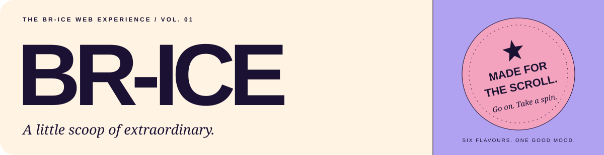
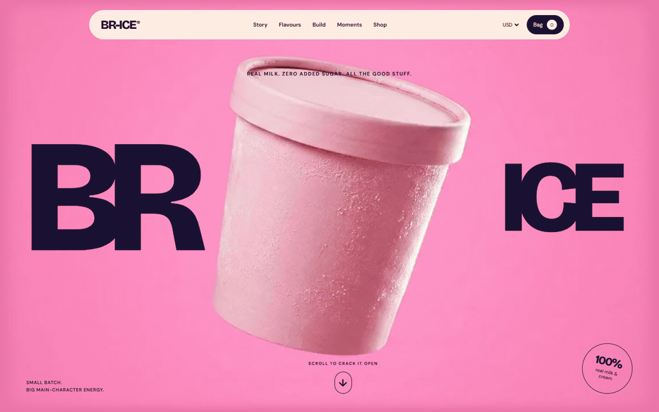
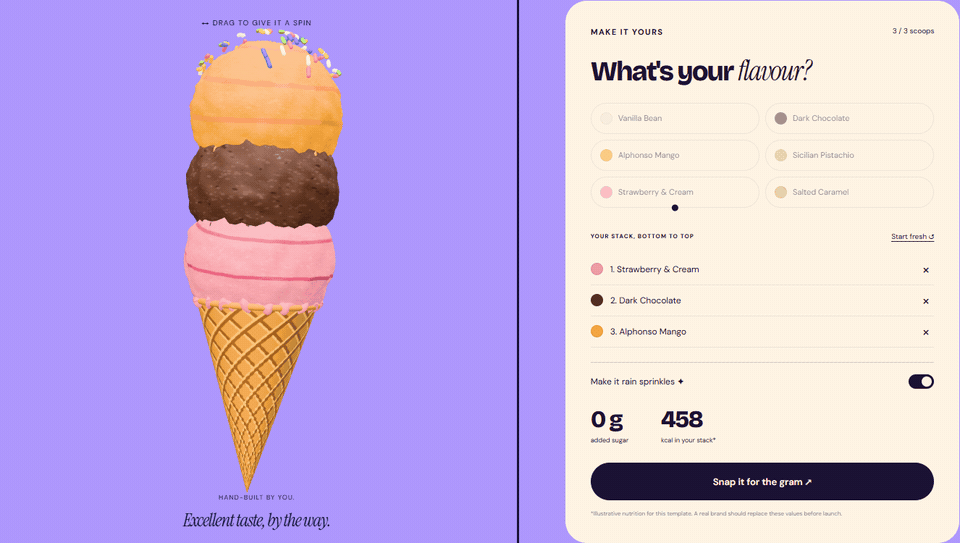
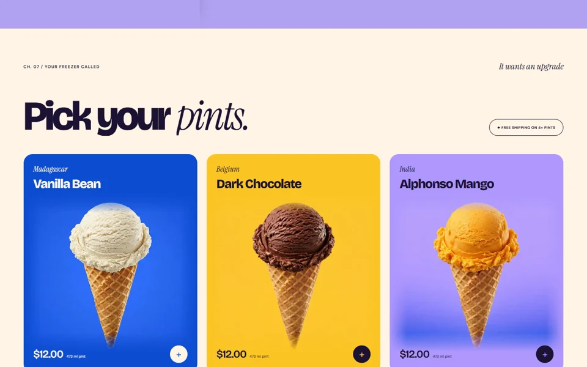
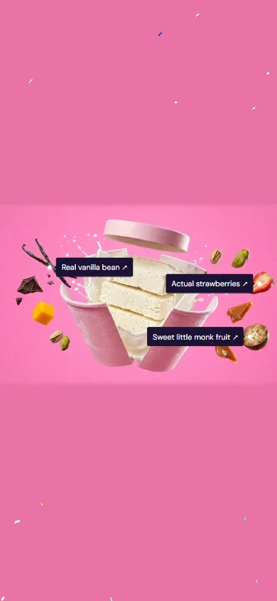

<div align="center">



### Big type. Real texture. A very good reason to keep scrolling.

A premium ice-cream storefront template with cinematic scroll films,<br>
a playful Three.js cone builder, and six flavours of personality.

**PLAIN HTML / CSS / JS** &nbsp; · &nbsp; **NO BUILD STEP** &nbsp; · &nbsp; **RESPONSIVE**

[Get started](#get-started) &nbsp; / &nbsp; [Explore the experience](#the-experience) &nbsp; / &nbsp; [Make it yours](#make-it-yours) &nbsp; / &nbsp; [Read the docs](#the-library)



<sub>Captured from the running website. Scroll-controlled motion, shown here as a looping GIF.</sub>

</div>

---

## A storefront with a story

BR-ICE takes visitors from the first crack of the pint to their own three-scoop creation. Oversized lettering, pastel colour fields, ingredient reveals, and tactile product films give each chapter its own rhythm.

| Six flavours | Three scoops | One command | 51.25 MB |
| :---: | :---: | :---: | :---: |
| A full-screen flavour theatre | An interactive cone, made by you | Start the local preview | Processed website media¹ |

## Get started

Open a terminal in the project folder. With Node.js installed, run:

```sh
node scripts/serve.mjs
```

Open **[localhost:4173](http://127.0.0.1:4173)**. That is the whole setup.

There is no dependency installation or build step for the website. Serve it over HTTP rather than opening `index.html` directly. The specified animation libraries and Google Fonts load from CDNs and need internet access.

<details>
<summary><strong>Another way to preview</strong></summary>

Any static HTTP server works. For example:

```sh
npx serve .
```

Use the address printed by that server. The included server binds to `127.0.0.1:4173`; a local preview is not a public deployment.

</details>

## The experience

| Chapter | What happens |
| :--- | :--- |
| **01 / Crack the pint** | A pinned, reversible video reveal, enormous BR / ICE lettering, instanced sprinkles, and ingredient labels. |
| **02 / Meet the ingredients** | A sugar-cube reveal leads into real-milk storytelling, animated counters, an arched film, and pasture photography. |
| **03 / Feel the texture** | A generous, pinned close-up lets the ice cream do the talking. |
| **04 / Find your flavour** | Six colour-soaked product scenes, wipe transitions, scroll-scrubbed films, and a flavour selector. |
| **05 / Build your own** | Stack up to three scoops, spin a procedural waffle cone, toggle sprinkles, and export your creation. |
| **06 / Collect the moments** | Seven photographs move through a horizontal gallery. |
| **07 / Fill the freezer** | Product cards, five currencies, a persistent bag, and a keyboard-friendly cart dialog. |
| **08 / Stay for dessert** | Floating scoops, newsletter validation, and a final invitation to the brand. |

## Your cone. Your rules.



**Choose → Stack → Spin → Snap.** Start with strawberry, add two more scoops, then drag horizontally or use the arrow keys to rotate. The snapshot button exports a **1080 × 1350 PNG** locally.

The waffle cone, scoop geometry, textures, lighting, and sprinkle meshes are created in Three.js. No external 3D model is needed.

<details>
<summary><strong>Prefer still previews? View desktop, mobile, and export examples.</strong></summary>

| Desktop shop | Mobile hero |
| :---: | :---: |
|  |  |

[Opening hero still](docs/readme/hero.webp) · [Example cone export](docs/readme/cone-export.webp)

</details>

## Made to move. Built to settle.

Motion is part of the experience, with explicit alternatives when it is unwanted or unavailable.

- **Reduced motion:** end-frame posters, no pinned sections or video scrubbing, no Lenis, and all six flavours in normal document flow.
- **Keyboard controls:** cone rotation with arrow keys; the bag traps focus, closes with Escape, and restores focus to its trigger.
- **Considerate rendering:** loops pause offscreen and when the tab is hidden; Three.js renders only while visible, with builder updates driven by changes and animation.
- **WebGL fallback:** explanatory messages appear if a browser cannot create the 3D scenes.

The GIFs in this README are recordings. A Markdown viewer may keep playing them independently of your system's motion preference; the website itself implements the reduced-motion behaviour above.

## Make it yours

| Change | Edit |
| :--- | :--- |
| Brand wording, chapter copy, and product claims | [`index.html`](index.html) |
| Colours, spacing, typography, and responsive layout | [`css/style.css`](css/style.css) |
| Flavours, origins, notes, scoop colours, and nutrition | `FLAVOURS` in [`js/main.js`](js/main.js) |
| Fixed prices for USD, EUR, GBP, INR, and JPY | `PRICES` in [`js/main.js`](js/main.js) |
| Cone geometry, textures, lighting, and PNG composition | [`js/three-scenes.js`](js/three-scenes.js) |
| Media metadata and sampled stage colours | [`media/manifest.json`](media/manifest.json) |

**One flavour collection, three interfaces.** The theatre, shop, and builder chips use the same `FLAVOURS` data, so product edits stay consistent.

<details>
<summary><strong>The stack, without the scaffolding</strong></summary>

| Layer | Implementation |
| :--- | :--- |
| Structure | Semantic HTML |
| Styling | CSS tokens and responsive layouts |
| Scroll and typography | GSAP 3.13.0 · ScrollTrigger · SplitText |
| Smooth scrolling | Lenis 1.1.13 |
| 3D scenes | Three.js 0.170.0 and addons via an import map |
| Type | Bricolage Grotesque · Instrument Serif · DM Sans |
| Local state | `localStorage` for the bag and currency |
| Local server | Node.js built-in modules |

No frontend framework, bundler, or external 3D-model dependency.

</details>

<details>
<summary><strong>Inside the animation system</strong></summary>

The loader waits for the fonts and hero clip, with a five-second maximum. Each scrub film is fetched completely into a blob URL before use; sugar and flavour clips then load sequentially in story order.

Near-viewport clips interpolate toward their target time at `0.2`, changing playback position only when the difference exceeds `8 ms` and the video is not already seeking. The last target is bounded to `duration − 0.05` seconds.

At page load, viewports of `760px` or less select the mobile scrub files. Reload when changing device classes during testing. Hero ingredient coordinates are normalised to the source film and mapped into its displayed cover bounds.

See the [development guide](docs/DEVELOPMENT.md) for implementation and replacement-media details.

</details>

<details>
<summary><strong>Replace and process the media</strong></summary>

Put source downloads in `assets/`. Update the filename-prefix mappings in the scripts, then run:

```sh
bash scripts/process.sh
python scripts/process-images.py
python scripts/verify-media.py
```

Processing requires Bash, FFmpeg/ffprobe, Python, and Pillow. Set `FFMPEG` and `FFPROBE` if the binaries are not on PATH. Source downloads and local development tools are excluded from the release ZIP.

Scrub files use silent H.264, faststart, no B-frames, and a maximum two-frame keyframe interval. The pipeline creates desktop/mobile variants, posters, shop images, a share image, and sampled background colours. Originals are preserved.

The supplied films are 720p and some have changing backgrounds. Read the [media report](docs/MEDIA-REPORT.md) before replacing them; it documents the source limitations, crop, mark-removal region, and output dimensions. Generation prompts are in the [asset prompt library](docs/ASSET_PROMPTS.md).

</details>

## The library

```text
BR-ICE/
├── index.html                 The complete storefront
├── css/style.css              Brand tokens, layout, and motion styles
├── js/
│   ├── main.js                Story, products, bag, and interaction
│   └── three-scenes.js        Sprinkle burst and procedural cone
├── media/                     Processed films, posters, and photography
├── scripts/                   Preview server and asset processing
├── docs/
│   ├── readme/                Self-contained README previews
│   ├── DEVELOPMENT.md         Setup and implementation guide
│   ├── QA.md                  Verification coverage and scope
│   ├── MEDIA-REPORT.md        Supplied asset details
│   └── ASSET_PROMPTS.md        Image and video prompt library
└── README.md                  You are here
```

[Development guide](docs/DEVELOPMENT.md) · [Verification record](docs/QA.md) · [Media report](docs/MEDIA-REPORT.md) · [Original brief](docs/ORIGINAL-BRIEF.txt)

[Image prompts PDF](docs/BR-ICE_Image_Prompts.pdf) · [Video prompts PDF](docs/BR-ICE_Video_Prompts.pdf)

## Checked, with the scope in view

Verified in Chrome at **1440 × 900**, **1024 × 768**, and **390 × 844**. Checks cover forward/reverse scrubbing, mobile media selection, the three-scoop limit, PNG export, bag controls, currency changes, modal focus, newsletter validation, reduced motion, and simulated WebGL failure.

All **19 processed videos** pass the included media verifier. The tested normal flows produced no JavaScript page errors. Safari, Firefox, and physical-device testing have not been performed. Full results: [QA.md](docs/QA.md).

## Before the first real order

The visual storefront and local interactions are implemented. **Checkout and newsletter are integration points**: connect a payment/store service and an email provider before launch. The current handlers clearly explain this, and do not take payments or submit subscriptions.

Replace illustrative prices, nutrition, product claims, shipping promises, city captions, and policies with verified brand information. Keep service secrets on your backend.

---

<div align="center">

**SIX FLAVOURS. ENDLESS GOOD TASTE.**

*Open the pint. Make it yours.*

[Back to the top](#) &nbsp; · &nbsp; [Start the preview](#get-started) &nbsp; · &nbsp; [Explore the code](js/main.js)

<sub>¹ Website media size excludes README previews and documentation. Animated previews are bundled locally; no external badge or GIF service is required.</sub>

</div>
